# Constancia del equipo para el Laboratorio 6: CODEBREAKERS

**Curso:** FDSI  
**Integrantes:** Jose Lancheros, Jeyder Leon y Juan Gomez  
**Elaborada:** 19 de noviembre de 2026  
**Sustentación:** realizada durante la clase, con el profesor presente. Fuimos el segundo grupo en presentar.

## Propósito

Dejamos por escrito la solución que explicamos y demostramos en vivo en el Laboratorio 6. El reto era descubrir la clave que pide el programa `reto_codebreakers_linux_x64` y lograr que mostrara la bandera. Como no tomamos capturas el día de la clase, esta constancia se reconstruye con los archivos del kit y con el proyecto de Ghidra que guardamos. Cada dato que aparece aquí se puede volver a comprobar con los comandos que están casi al final.

## Resultado

| Dato | Valor |
|---|---|
| Clave descubierta | `BREAKER#2026` |
| Mensaje con la clave correcta | `ACCESO CONCEDIDO` |
| Bandera | `FLAG{CODEBREAKERS_ECI}` |
| Mensaje con una clave incorrecta | `ACCESO DENEGADO` |

## El archivo analizado

Es un ejecutable ELF de 64 bits para Linux x86-64, enlazado dinámicamente y con los símbolos sin quitar. Por eso Ghidra puede mostrar nombres como `main`, `aes_ct`, `sbox`, `rsbox` y `add_round_key`, que ya delatan que el programa trae su propia implementación de AES. También aparece `reto_codebreakers.c` como nombre del código fuente original, que nunca recibimos. El compilador fue GCC de Debian 14.2.0.

El programa no guarda la contraseña en texto plano. Guarda un texto cifrado, una clave y un vector de inicialización. Al ejecutarse descifra el texto y lo compara con lo que escribe la persona.

## Procedimiento

1. Creamos en Ghidra un proyecto no compartido llamado `ECI_CODEBREAKERS` e importamos el archivo. Ghidra lo cargó con el lenguaje `x86:LE:64:default`, es decir x86 de 64 bits y little endian.
2. Corrimos el análisis automático y abrimos el CodeBrowser con las ventanas Listing y Decompiler.
3. Usamos `Search > for Strings`. Salieron 24 cadenas, entre ellas los mensajes del programa: el título de la bóveda, la petición de la clave, `ACCESO CONCEDIDO`, la bandera y `ACCESO DENEGADO`. En esa lista no aparecieron la clave ni el IV, porque están pegados en la sección de datos sin un texto que Ghidra los separe.
4. Seguimos las referencias de los mensajes hasta la función `main`, que en Ghidra está en `001010c0`. Allí el programa lee la entrada con `fgets`, le quita el salto de línea con `strcspn` y luego recorre las rondas de AES usando la tabla `sbox` y la función `add_round_key`. En el desensamblado se ven las referencias a los datos `DAT_00102300` y `DAT_00102320`, que son la clave de 32 bytes `CodeBreakersECI_AES256_KEY_2026!` y el vector de inicialización de 16 bytes `ECI_VECTOR_2026!`.
5. Al final de `main` está la comparación. El texto descifrado se pasa a `strcmp` junto con la entrada. Si `strcmp` devuelve 0, el programa imprime `ACCESO CONCEDIDO` y la bandera. Si no, imprime `ACCESO DENEGADO`.
6. Con la clave, el IV y el bloque cifrado de `aes_ct` desciframos con OpenSSL y salió `BREAKER#2026`.
7. Escribimos esa clave en el validador de la guía, que respondió con acceso concedido y la bandera. Después lo demostramos en vivo al profesor.

## Datos técnicos de la solución

El bloque cifrado de 16 bytes está en el binario con la etiqueta `aes_ct`. En hexadecimal es:

```
d67f5789f451afebf2b6e566f87fb979
```

Los parámetros del cifrado son estos:

- Algoritmo: AES-256 en modo CBC.
- Clave: `CodeBreakersECI_AES256_KEY_2026!`, que tiene justo 32 caracteres.
- IV: `ECI_VECTOR_2026!`, que tiene justo 16 caracteres.
- Relleno: PKCS7. El texto `BREAKER#2026` tiene 12 caracteres, así que se agregan 4 bytes de relleno para completar el bloque.

Las direcciones útiles en Ghidra, que usa la base 0x100000 sobre el desplazamiento del archivo, son:

| Qué es | Dirección en Ghidra |
|---|---|
| Función `main` | `001010c0` |
| Llamada a `strcmp` | `00101a52` |
| Mensaje ACCESO CONCEDIDO | `001020a2` |
| Bandera | `001020b3` |
| Mensaje ACCESO DENEGADO | `001020ca` |
| Texto cifrado `aes_ct` | `001020e0` |
| Clave e IV | `00102300` y `00102320` |

La última posición que guardó Ghidra en nuestro proyecto es `001019df`, dentro de `main` y en la vista del Decompiler, poco antes de la comparación con `strcmp`. Eso encaja con que estuvimos revisando esa parte.

## Cómo comprobar el resultado

Se puede repetir sin ejecutar el binario. Desde la carpeta del kit, este comando descifra el bloque con la clave y el IV encontrados:

```bash
echo d67f5789f451afebf2b6e566f87fb979 | xxd -r -p | openssl enc -d -aes-256-cbc -K $(printf 'CodeBreakersECI_AES256_KEY_2026!' | xxd -p -c64) -iv $(printf 'ECI_VECTOR_2026!' | xxd -p -c64)
```

La salida es `BREAKER#2026`. Para ver la comparación y los textos dentro del binario sirven estos:

```bash
objdump -d -M intel reto_codebreakers_linux_x64 | grep -n strcmp
strings reto_codebreakers_linux_x64 | grep -E 'ACCESO|FLAG|CodeBreakers|ECI_VECTOR'
```

En un Linux x86-64 o en WSL también se puede correr el programa, escribir `BREAKER#2026` y ver el acceso concedido.

## Capturas

Estas imágenes no son de la clase. Las generamos el 19 de noviembre de 2026 al repetir la solución con los mismos archivos del kit, para dejar evidencia visual de cada resultado. Las de Ghidra son del proyecto del laboratorio abierto de nuevo. Las de terminal muestran la salida real de cada comando y las del validador son la guía HTML del laboratorio con la clave escrita.

**Captura 1. El validador de la guía acepta la clave y muestra la bandera**

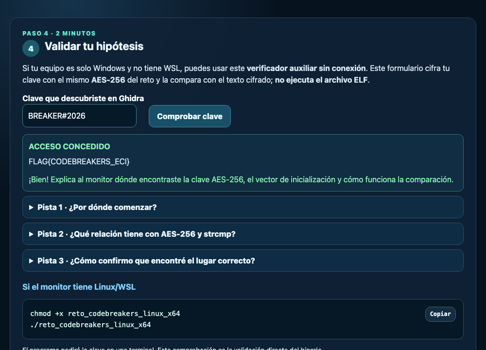

**Captura 2. El mismo validador rechaza una clave incorrecta**

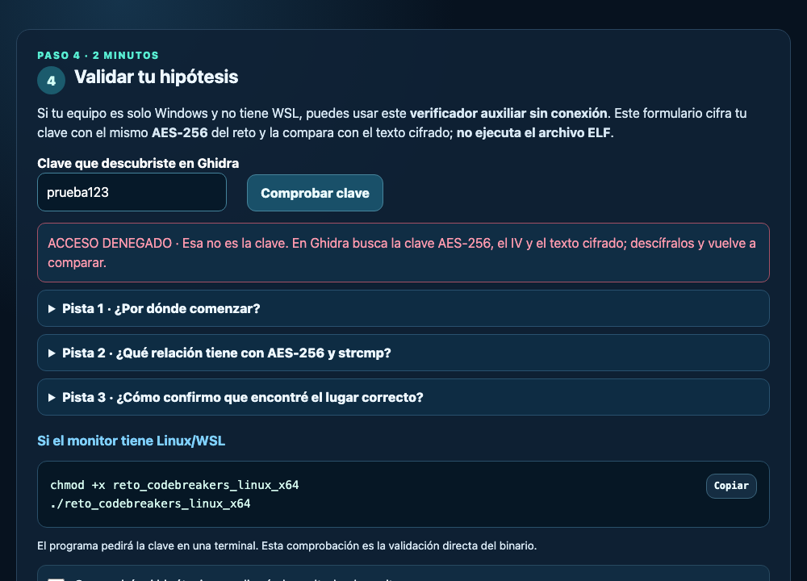

**Captura 3. Descifrado del bloque aes_ct con OpenSSL**

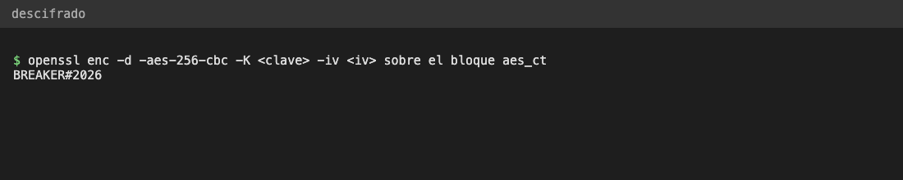

**Captura 4. Cadenas del binario, con los mensajes, la clave y el IV**

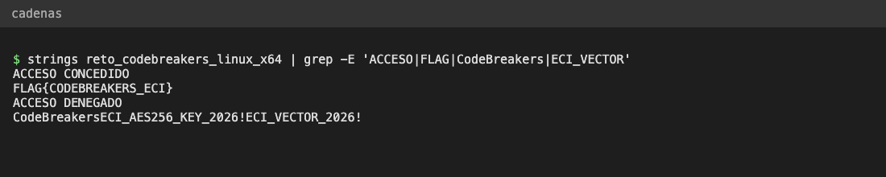

**Captura 5. La llamada a strcmp y los dos caminos del if dentro de main**

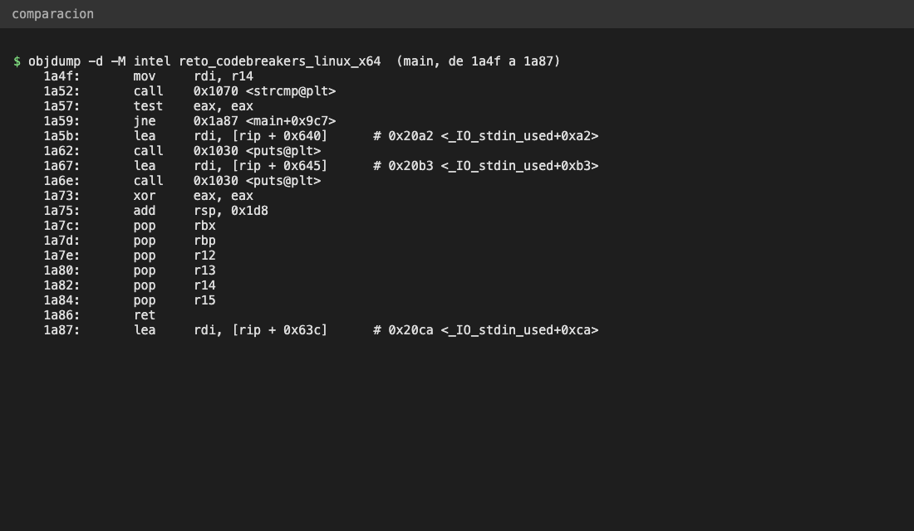

**Captura 6. El proyecto ECI_CODEBREAKERS abierto en Ghidra, en main con el Decompiler**

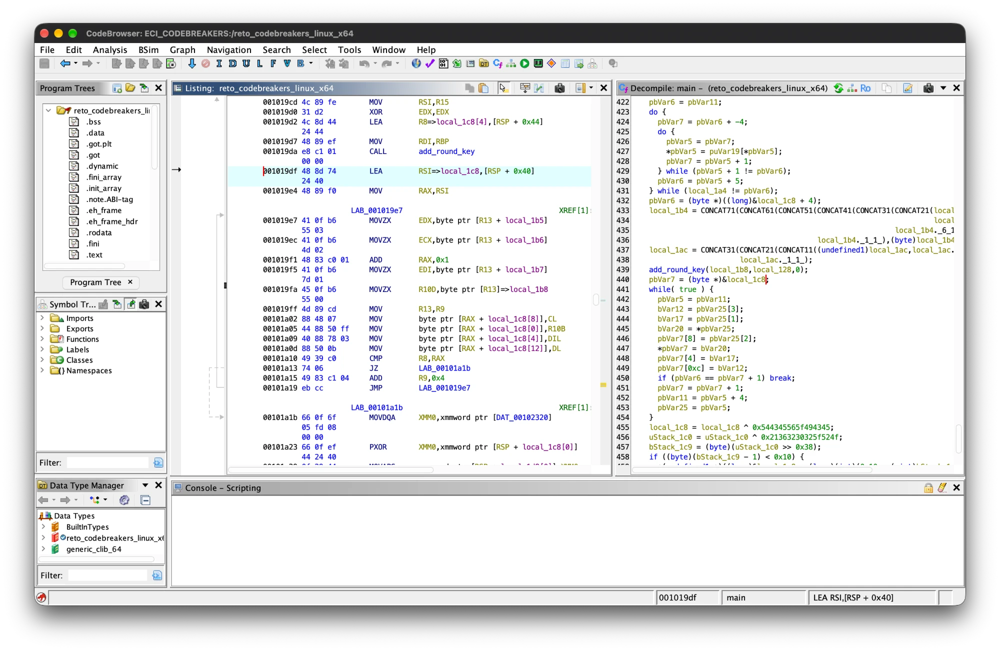

Esta sí es del proyecto de Ghidra que guardamos en el laboratorio, abierto de nuevo el 19 de noviembre de 2026. Se ve el programa `reto_codebreakers_linux_x64` en el CodeBrowser, el cursor en `001019df` justo después de la llamada a `add_round_key`, la función `main` en el Decompiler y los datos `DAT_00102320` y las constantes que se combinan con XOR antes de la comparación.

**Captura 7. Search for Strings con los 24 resultados, parado en el título de la bóveda**

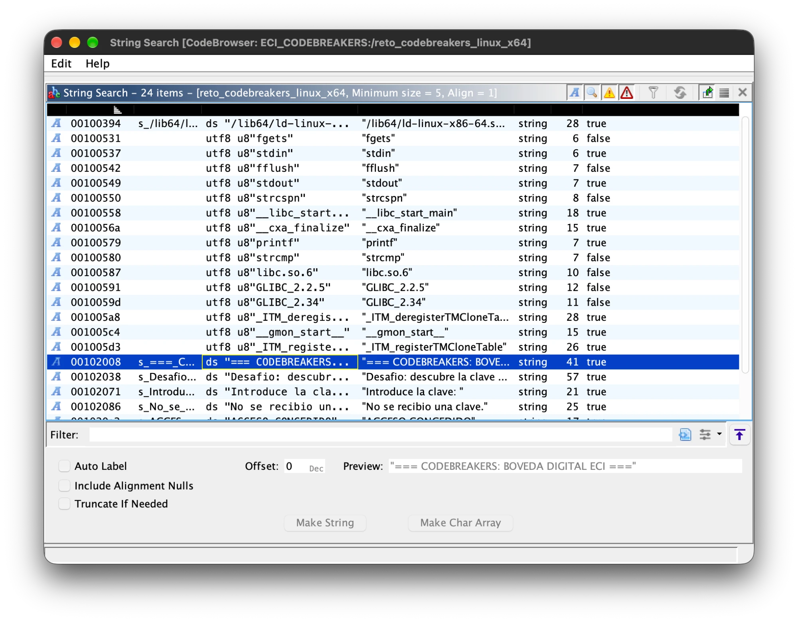

**Captura 8. La cadena ACCESO CONCEDIDO en 001020a2**

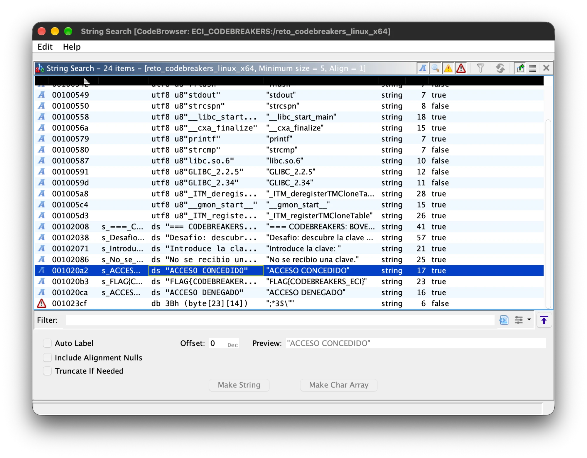

**Captura 9. La bandera FLAG{CODEBREAKERS_ECI} en 001020b3**

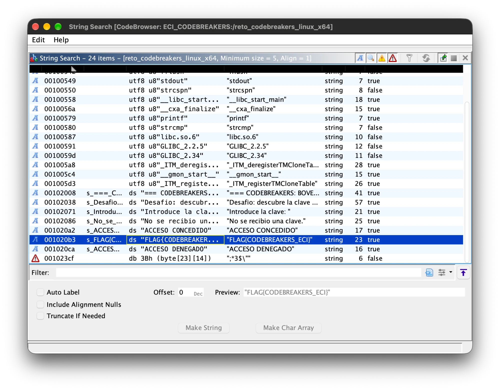

**Captura 10. La cadena ACCESO DENEGADO en 001020ca**

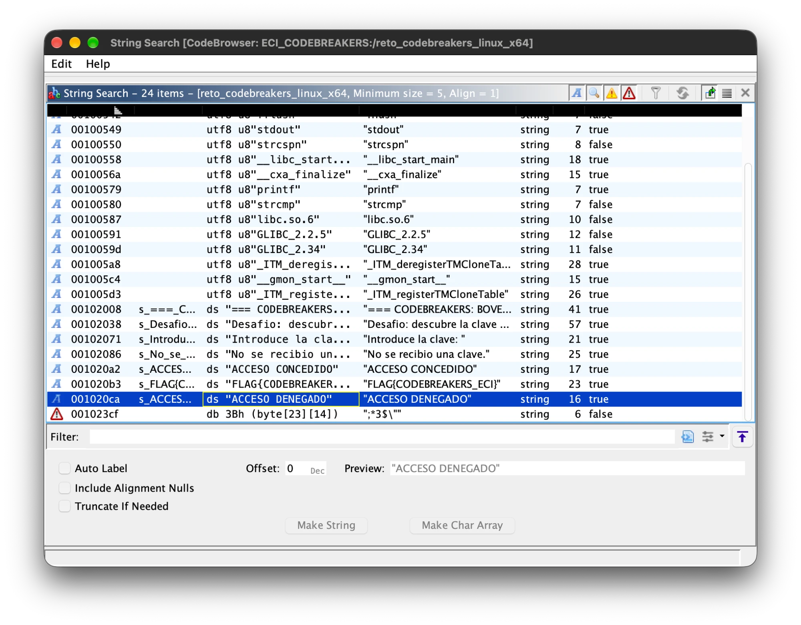

**Captura 11. La comparación en el Decompiler**

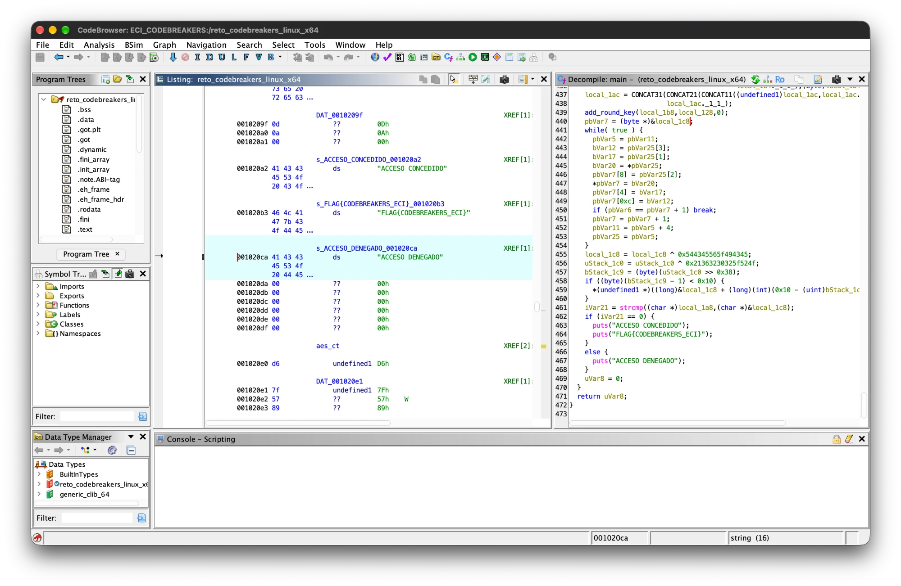

En esta última se ve `iVar21 = strcmp(...)`. Si `iVar21 == 0` el programa hace `puts` de `ACCESO CONCEDIDO` y de la bandera. En el `else` hace `puts` de `ACCESO DENEGADO`. En el Listing se ve además `aes_ct` en `001020e0`, el bloque cifrado que se descifra antes de comparar.

**Captura 12. El proyecto ECI_CODEBREAKERS con el programa importado**

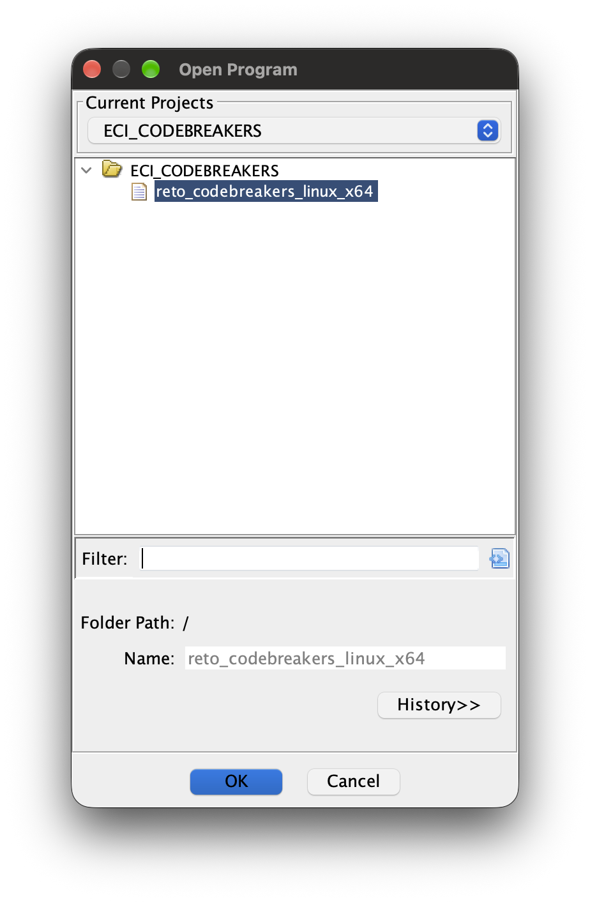

Es la ventana Open Program de Ghidra. Muestra el proyecto `ECI_CODEBREAKERS` y dentro el archivo `reto_codebreakers_linux_x64`, que es la evidencia de que el ELF fue importado al proyecto.

## Reflexión

Aunque la contraseña esté cifrada con AES-256, la clave y el IV viajan dentro del mismo ejecutable. Quien tenga el archivo puede sacarlos con una herramienta como Ghidra y descifrar el texto, que fue justo lo que hicimos. El cifrado solo hace el trabajo un poco más largo y no resuelve el problema de fondo. Para proteger una contraseña de verdad no se debe dejar una clave fija dentro del programa que se entrega. Es mejor guardar solo un hash con sal en un servidor que controle quien administra el sistema.

## Alcance y evidencia

Esta constancia registra lo que hicimos como equipo. No tomamos capturas durante la sustentación. Las imágenes de la sección Capturas se hicieron después, al repetir la solución, y así están indicadas. Lo escrito se respalda con estos archivos del kit:

- `reto_codebreakers_linux_x64`, de donde salen los mensajes, el bloque cifrado, la clave, el IV y la llamada a `strcmp`.
- `ECI_CODEBREAKERS.rep`, el proyecto de Ghidra que guardamos el 4 de noviembre, con el programa importado y la última posición dentro de `main`.
- `CODEBREAKERS_Guia_Estudiantes_Windows.html`, la guía con el validador que acepta `BREAKER#2026` y muestra la bandera.
- `LEEME_RETO.md`, con las reglas y las evidencias que pedía el laboratorio.

La presencia del profesor se menciona solo como parte de la sustentación. Este documento no es una certificación del profesor y no consigna una calificación.
